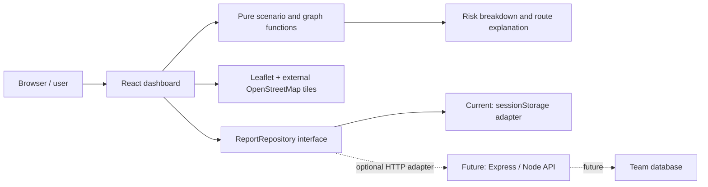
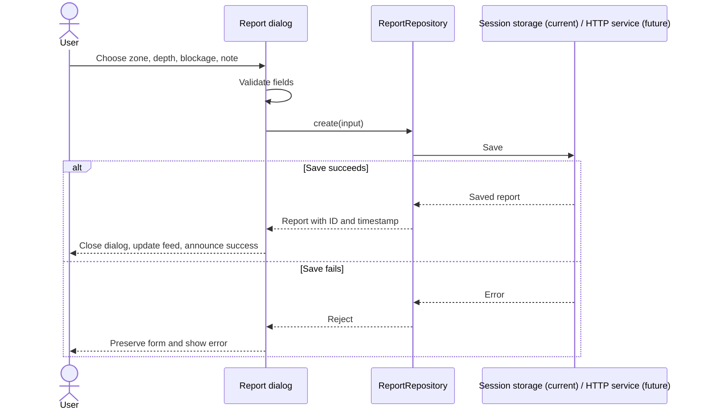
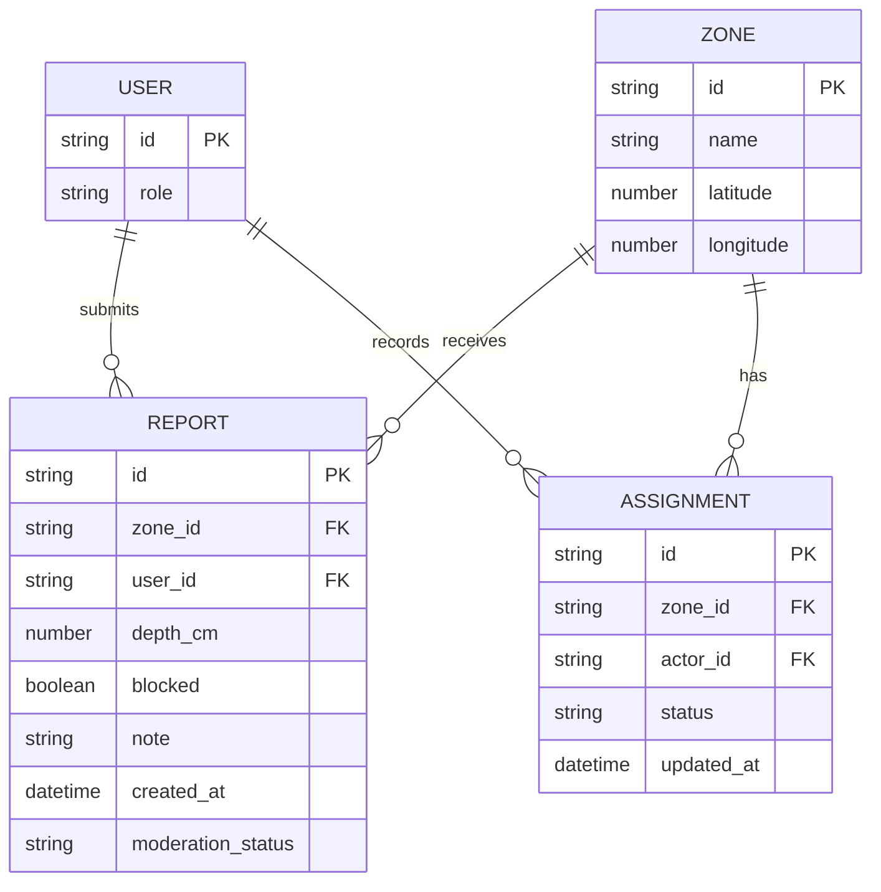

# FloodSense: Phase 1 engineering and review guide

## Problem and scope

Bengaluru commuters need understandable location-level information about waterlogging and potential route exposure. Community contributors need a simple observation workflow. The operations view demonstrates how response status could be monitored separately from environmental conditions.

This project currently demonstrates those workflows with six sample locations and a synthetic road graph. It is not an emergency alert service, calibrated hydrological model, or real road-navigation product. Location vulnerability/history values are illustrative assumptions, not measurements. No claimed prediction accuracy or percentage reduction in journey time is supported yet.

### Objectives and evaluation

| Objective                                               | Evidence/check                                                                                                      |
| ------------------------------------------------------- | ------------------------------------------------------------------------------------------------------------------- |
| Make scenario results understandable                    | Every displayed zone score has a breakdown from the same calculation; factor sum, rounding and cap are tested.      |
| Support reporting without misleading persistence claims | Session mode is explicitly labelled; a saved report survives refresh in the same tab; storage failures are visible. |
| Demonstrate risk-weighted routing                       | Tests check graph connectivity and avoidance of a high-risk intermediate node when a lower-cost path exists.        |
| Keep core controls accessible                           | Manual keyboard walkthrough covers menu, zone selector, sliders, report dialog, Escape and focus return.            |
| Prepare for backend integration                         | A typed repository isolates persistence; the HTTP contract and error handling are tested without a real database.   |

To substantiate the problem statement in the presentation, the team should add cited local flood evidence and actual user interviews. Do not invent interview results. SDG 11 relates to city resilience and accessible local information; SDG 13 relates to exploring rainfall exposure. These are design alignments, not measured impact claims.

## Architecture



Next.js supplies the React application/build structure, TypeScript expresses shared data contracts, Tailwind/custom CSS provide responsive styling, and Leaflet handles map presentation. The map has keyboard-accessible location controls and failure feedback; the zone information does not depend on successful tile downloads.

The existing Next.js frontend is React-based. If the course requires MERN, MongoDB and Express must actually be implemented. PostgreSQL through the team's proposed Supabase service is a different database choice and requires instructor acceptance. This frontend work does not implement either backend.

The original CARTO endpoint returned an API-key-required tile during visual QA. The frontend now uses attributed OpenStreetMap standard tiles. These are a best-effort community service for modest interactive use, not guaranteed production infrastructure. Honour the [tile usage policy](https://operations.osmfoundation.org/policies/tiles/), browser caching and Referer defaults; do not add prefetch/offline downloads. Automated UI checks intercept tile requests to avoid generating test traffic. Evaluate a contracted provider if usage grows.

## Interface and workflow

```text
Overview: metrics -> map / timeline -> selected location + score explanation
Risk explorer: map + keyboard zone controls -> zone register
Routes: origin / destination -> path comparison + decision explanation
Reports: filter controls -> labelled observations -> accessible report dialog
Operations: zone register -> local assignment status; no physical risk reduction
```



Optional images are local previews only: validate JPG/PNG/WebP and a 5 MB limit, show the image, release its object URL on removal/unmount. No image is uploaded or stored with reports. Session reset requires an explicit confirmation and affects only this tab's reports.

## Risk and route method

For zone vulnerability `v`, sample history `h`, scenario rainfall curve `R(t)`, and accumulated rainfall `A(t)`:

- History contribution = `16h`.
- Rainfall contribution = `0.7vR(t)`.
- Accumulation contribution = `2.2vA(t)`.
- Reported blocked drain adds `0.35 * (rainfall + accumulation contributions) + 6`.
- Each observation adds 3 points below 20 cm, 6 below 40 cm, or 10 otherwise; total observation contribution is capped at 20.
- Sum, round, then constrain to `[0,100]`. Low `<35`, watch `35..64`, high `>=65`.

Assignment status contributes zero. Assigning a team is not evidence of physical mitigation. Repeated or unverified reports can influence the heuristic; future moderation, deduplication and freshness rules must be designed before real use.

Routes use a six-node undirected illustrative graph and a Dijkstra-style shortest path. Baseline edge weight is approximate straight-line distance; the risk-aware weight adds 70% of distance at watch level or 500 synthetic cost units at high risk, based on the maximum endpoint risk. These weights express a demonstration preference, not road closure or guaranteed avoidance. Starting/destination zones may remain high risk. Reported travel minutes are synthetic estimates.

## Future data design (proposed, not created)



Use database foreign keys/constraints or equivalent server validation for the selected database. Users may only modify records allowed by ownership/role policy. Keep privileged database credentials on the server. Frontend validation is UX support, not a security boundary.

## Integration contract

No `NEXT_PUBLIC_API_BASE_URL` means session mode. To explicitly opt into the future API, set that public variable to an API prefix, for example `https://dev-api.example/api`, then rebuild. It is an address, never a secret. There is no silent fallback from HTTP to local storage: a failed service must remain visible.

| Endpoint              | Request                      | Success response               |
| --------------------- | ---------------------------- | ------------------------------ |
| `GET {base}/reports`  | Optional cancellation signal | JSON array of reports          |
| `POST {base}/reports` | `{zone, cm, blocked, note}`  | One saved report; use HTTP 201 |

Report response: `{id: string, zone: known zone ID, cm: number 0..200, blocked: boolean, note: string <=400 chars, timestamp: Unix milliseconds, source?: 'sample'|'community'}`. Missing source defaults to community. The UI sets `minutes: null` internally and derives elapsed time from `timestamp`.

The adapter sends `credentials: include`; the backend must support its chosen cookie/session auth, exact allowed frontend origins, credentialed CORS when cross-origin, appropriate CSRF protection for writes, server-side validation and rate limits. The team may replace this with its agreed token transport; do not put privileged keys in client code. Reads time out/cancel; writes use a 12-second timeout. A timed-out write may have reached the server: check the feed before retrying; future APIs should add idempotency keys.

The contract currently assumes a small report list. Add pagination, moderation and stale-data policies with the backend team as usage grows. The static frontend zone catalog remains the source of accepted IDs until the team agrees a zones endpoint. Existing sample reports never get uploaded automatically.

## Rubric evidence

| Criterion                | Evidence available                                                                         | Still team-owned                                    |
| ------------------------ | ------------------------------------------------------------------------------------------ | --------------------------------------------------- |
| Problem identification   | Explicit users, objectives, boundaries and SDG rationale                                   | Local evidence, interviews, final objectives        |
| Analysis/design          | Architecture, sequence, interface structure, proposed ER model and contract                | Final backend/database design and source wireframes |
| Technical implementation | Typed repository, tested model and routing, session reporting, errors, image preview       | Working authenticated backend and database          |
| UX                       | Keyboard controls, native modal, consistent status, reduced motion and useful explanations | Broader usability/accessibility evaluation          |
| Participation            | Issue #3, implementation branch, reviewable PR                                             | Actual contributions and each member's explanation  |
| Presentation             | Demo script below and explicit limitations                                                 | Rehearsal and answers from the whole team           |

## Demo script and manual QA

1. Start with overview; show the session-data status and selected location explanation.
2. Change rainfall and time; verify factors update and total matches the badge.
3. Assign/recall a team in operations; verify the score stays unchanged.
4. Compare routes under heavy rain; explain penalties and identical-path cases.
5. Open the form using a keyboard. Tab stays in the modal, Escape closes it and returns focus. Check a valid preview and rejection of oversized/unsupported images.
6. Submit, filter, refresh, and inspect age/source labels. Refresh the page in the same tab and verify persistence. Reset only after confirming the prompt.
7. Block OpenStreetMap tile requests in browser devtools: message and retry appear; zone buttons remain usable.
8. Test a 390px viewport, no horizontal page overflow, mobile menu and CSV export. Enable reduced motion and verify no meaningful animation remains.
9. Test invalid session JSON and blocked storage: a visible error replaces any false success; reset/retry recovers when storage is available.
10. In API mode, exercise the teammate's development endpoint only. Confirm failure does not silently create a session report. Inspect that no private key is bundled.

Automated checks: `npm run lint`, `npm run typecheck`, `npm test`, `npm run build`. Tests cover bounded calculations, threshold boundaries, contribution caps, routing edges/risk penalties, persistence across repository instances, invalid input/storage failures, ages, HTTP request contract and server errors. CI runs these on pull requests to main. Add the resulting `frontend` job as a required repository check after its first successful run; the workflow alone does not change branch protection.
